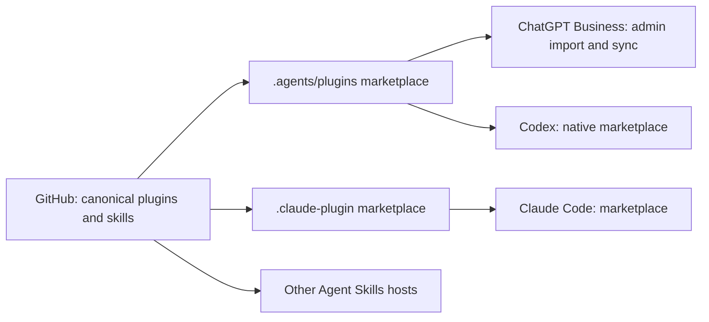

# Architecture

## Purpose and boundaries

The repository is the source of truth for static AI plugins and Agent Skills maintained by
Onderwijs in. It organizes reusable capabilities for discovery and installation in AI workspaces,
with ChatGPT Business as the primary distribution target and shared content portable across hosts.

A skill defines when and how to perform a reusable task through Markdown instructions and local
resources. A plugin is an independently distributable package of skills and optional service
connections. A marketplace indexes packages for a provider. MCP exposes external tools and data
at runtime; repository scripts support authoring and validation.

Portable content and packaging preserve shared instructions. Each host determines its execution
environment, available tools, authentication, and permissions. Compatibility is established per
capability and provider, not inferred from marketplace membership.

## Canonical content and provider metadata

| Location                           | Architectural responsibility                                            |
| ---------------------------------- | ----------------------------------------------------------------------- |
| `plugins/<name>/`                  | Independently distributable plugin package and bundled resources        |
| `skills/<name>/`                   | Independently usable standalone Agent Skill                             |
| `.agents/plugins/marketplace.json` | Primary ChatGPT/Codex discovery catalog                                 |
| `.claude-plugin/marketplace.json`  | Claude-compatible discovery catalog                                     |
| `.agents/skills/`                  | Contributor-facing agent skills, separate from distributed capabilities |
| `scripts/`                         | Lightweight repository authoring and validation utilities               |
| `docs/`                            | Authoring, administration, setup, and compatibility guidance            |
| `.github/`                         | Review, validation, and repository maintenance configuration            |
| `.vscode/`                         | Contributor editor configuration                                        |

Each capability has one authored source. Marketplace entries reference the same canonical plugin
directories and agree on identities. Provider-specific manifests and extensions contain only the
metadata or configuration required by their host; they do not duplicate shared skill instructions.

Plugin identity belongs in the root portable `plugin.json`. Bundled skills and resources belong
inside the plugin's distribution boundary. Standalone skills retain their own ownership and
installable boundary. Reuse across those boundaries requires an explicit ownership model and a
deterministic packaging strategy that produces self-contained artifacts without maintaining
multiple authored copies. Cross-directory references and symlinks do not provide that guarantee.

## Authoring, review, and validation

A capability moves from a proposal with user needs and intended hosts to authored content,
validation, host testing, and maintainer review. Approved content and catalog changes enter GitHub
together. Workspace administrators control how reviewed content becomes available to colleagues.

Validation enforces package identities, required files, metadata, resource boundaries, and
consistency between catalogs and canonical content. Format and lint checks support readable,
maintainable instructions. Runtime testing establishes installation, activation, resource access,
and representative behavior on each claimed host. Structural validation and runtime verification
serve distinct purposes; neither substitutes for the other.

Repository tooling remains a small support layer. Scripts implement focused checks or authoring
operations; additional dependencies and abstractions require a concrete need. CI validates changes
with reproducible dependency installation and minimal permissions. The operational contract for
agents is [AGENTS.md](AGENTS.md); authoring and check procedures belong in [docs/](docs/).

## Distribution and workspace governance

GitHub catalogs define discoverable packages. ChatGPT Business administrators import the primary
marketplace and use provider-managed GitHub synchronization. Installation policies, connected-app
permissions, and member authentication remain separate workspace controls. Codex and Claude consume
their respective native catalogs; standalone skills use a host's Agent Skills installation route.

Repository review governs source changes. Workspace policy governs consumption. Public repository
access, workspace import, and publication in a provider's public directory are separate distribution
boundaries. Administrator procedures and provider-specific behavior are documented in the
[marketplace distribution guide](docs/marketplace-distribution.md).

## External content and services

Static plugin and skill content remains authoritative in GitHub. A capability that consumes
externally managed organizational instructions or references accesses them through an explicit
integration boundary. The external system owns its data, access control, versions, and publication
process; the plugin owns discovery and use of that data within its documented permissions.

Directus-managed references are one possible application of this boundary. Discovery, editing,
validation, or publication through MCP requires a separately defined capability with explicit
review, authentication, and availability contracts. External content management does not replace
GitHub ownership of static packages.
